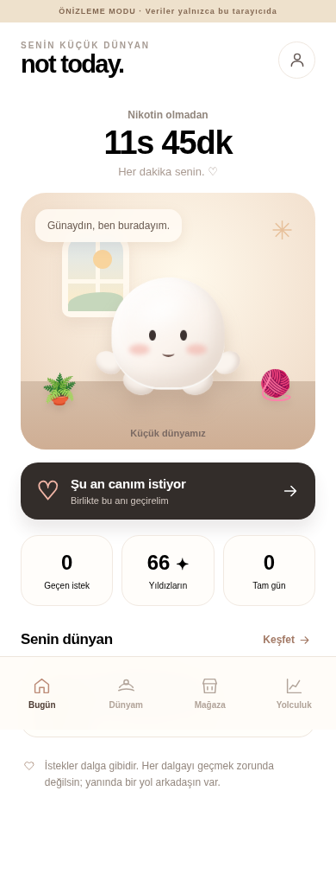

# not today. ♡

**Küçük bir dünya. Kocaman bir başlangıç.**

A mobile-first smoking / heated-tobacco quitting companion with email OTP, a persistent cozy world, cosmetic shop, personal memory jar, breathing, original generative music, memory matching and 3D-style smooth bubbles.

## Başlamak için

**Kod yazmadan yayına alma:** [Türkçe adım adım Vercel + Supabase + GitHub kılavuzu](docs/DEPLOY_TR.md).

- Root app: `index.html` (vanilla HTML/CSS/JS; no dependency install or build required)
- UI: `src/app.js`, `src/styles.css`, `src/catalog.js`, `src/audio.js`
- Supabase data/API client: `src/api.js` (Supabase JS browser library via CDN)
- Runtime public Vercel config: `api/config.js`
- Database schema, policies, RPCs and shop catalog: `supabase/001_initial.sql`
- Email OTP template: `docs/EMAIL_OTP_TEMPLATE.html`
- Privacy disclosure placeholder: `privacy.html` (**must be legally completed before launch**)

## Development

Open `index.html` via a static server (e.g. `python3 -m http.server 8000`). If no Vercel `/api/config` endpoint is provided, the app opens a **browser-local preview/demo**. On a configured Vercel deployment, it requires a real Supabase email OTP login; demo is not a login bypass.

### Vercel environment variables

- `SUPABASE_URL` — public project URL
- `SUPABASE_PUBLISHABLE_KEY` — public publishable API key, **never service_role**
- `TURNSTILE_SITE_KEY` — optional Cloudflare public site key; when present, OTP request screen includes a Cloudflare Turnstile challenge. Configure the corresponding **secret** only in Supabase Authentication anti-bot settings.

## Privacy and security

- RLS enabled per user on exposed tables.
- Coins/rewards/purchases validated in PostgreSQL `SECURITY DEFINER` RPC functions; users have no direct balance write access.
- Each user's notes/history are isolated by ownership policies.
- Account deletion invokes a self-only RPC that cascades application data.
- Local demo stores state on that browser only.
- No advertising SDK, analytics, real-money transactions, or diagnostic medical claims.
- Launch blocker: privacy operator placeholders, SMTP, anti-bot protection and complete end-to-end account / RLS tests.

## Screens

`Welcome / Email OTP → Onboarding → Home → Moments / World / Shop / Journey / Jar / Settings`

The app tracks a **current** smoke-free streak plus a persistent journey. A lapse does not delete the world, purchased items or personal notes.

## Version

1.0 pre-launch release candidate, 9 November 2026. Real Supabase email flows and production account deletion require testing with your own credentials and project before public release.
